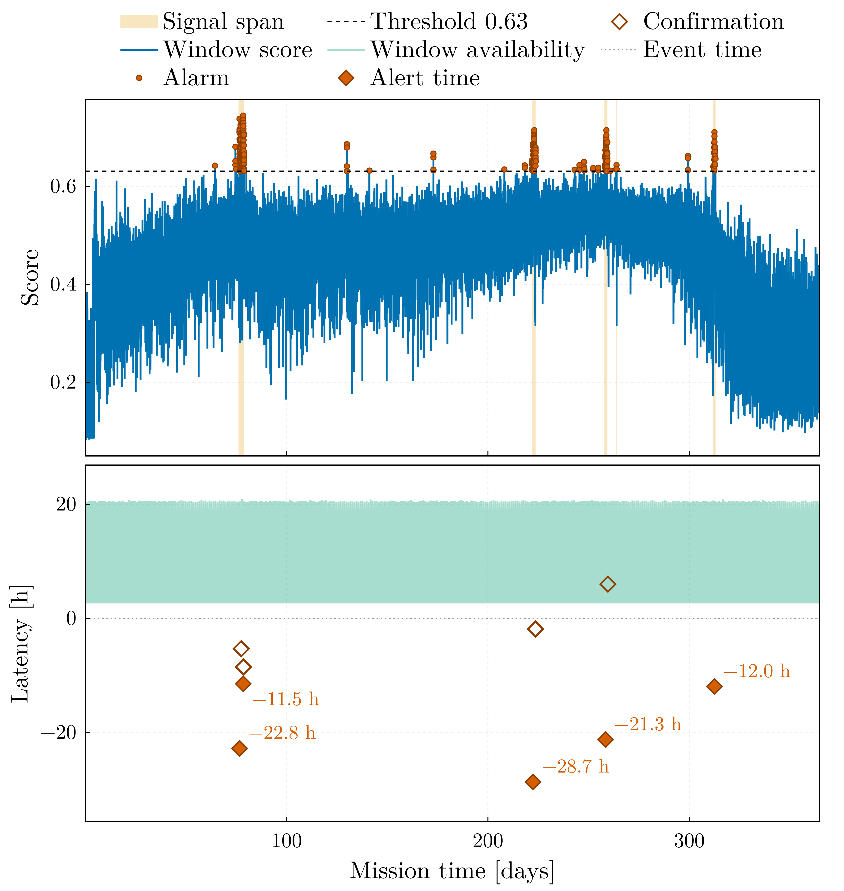
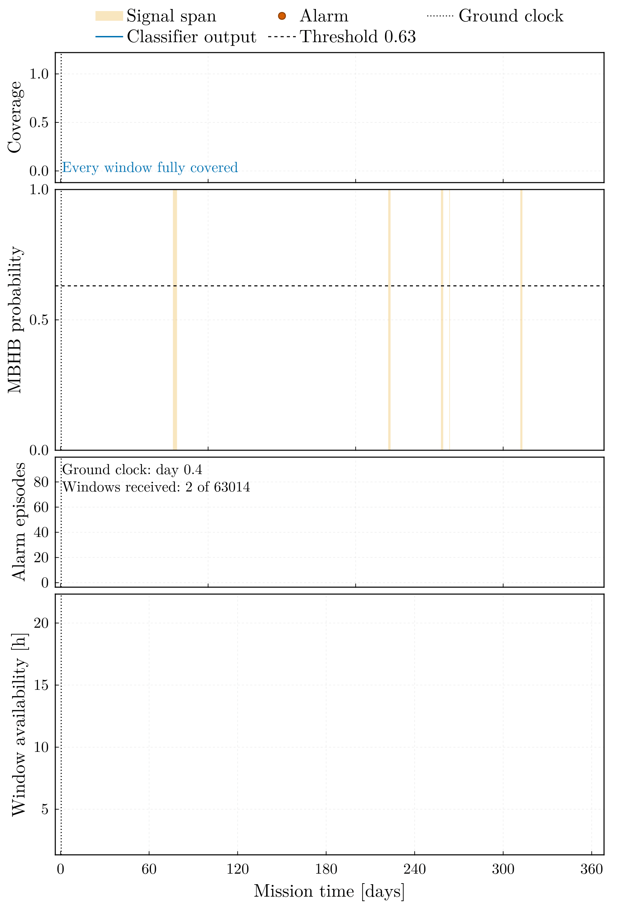
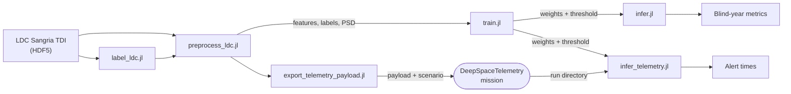

# MilliHertzQML.jl

[](https://github.com/PaulGoG/MilliHertzQML.jl/actions/workflows/CI.yml)
[](https://codecov.io/gh/PaulGoG/MilliHertzQML.jl)
[](https://PaulGoG.github.io/MilliHertzQML.jl/stable/)
[](https://github.com/PaulGoG/MilliHertzQML.jl/releases)
[](https://julialang.org/)
[](https://github.com/JuliaTesting/Aqua.jl)
[](LICENSE)

MilliHertzQML.jl is a variational quantum classifier that flags the
coalescences of massive black hole binaries (MBHBs) in LISA
time-delay-interferometry (TDI) data. It scores the data window by window,
in a completed record and in a replay of the record streamed through a
simulated telemetry downlink.

The data are those of the LISA Data Challenge (LDC) 2a "Sangria" data set:
one simulated year for training, and a second, "blind" year whose source
catalogue was withheld until evaluation. On the completed blind year, the
selected configuration, chosen on the training year, detects the five
labelled coalescence spans (two of the six coalescences share one span)
at 1.57 false alarms per 30 days. With the blind
year streamed through a simulated downlink and whitened causally, from
data already on the ground, the streaming configuration alerts five of the
six coalescences 11 to 29 hours before their merger.

The principal limit is that a logistic regression on the same eight
features does at least as well as the circuit. The detection rests on the
conditioning of the data and on the features, not on the circuit.

The circuit uses data re-uploading. It is simulated with `Yao.jl` and
differentiated by its reversible (adjoint) mode; the optimiser comes from
`Optimisers.jl`. The classification approach follows Isfan et al.,
*Class. Quantum Grav.* **42** 225001 (2025), DOI
[10.1088/1361-6382/ae1787](https://doi.org/10.1088/1361-6382/ae1787),
reimplemented in Julia in place of the original Python and Qiskit code.

The package is the classifier of a set of three:

- [StreamingInference.jl](https://github.com/PaulGoG/StreamingInference.jl)
  holds what depends neither on the physical domain nor on the method:
  the conditioning of a streamed record, the estimator interface, the
  replay of a telemetry mission, evaluation, configuration and provenance;
- [MilliHertzBase.jl](https://github.com/PaulGoG/MilliHertzBase.jl) holds
  the gravitational-wave layer: the LISA noise models, waveforms, the
  readers of the LDC products, labelling, and the coupling to a telemetry
  producer;
- MilliHertzQML.jl holds the circuit, its training, and the classical
  controls on the same features, and re-exports the two layers, so that
  `using MilliHertzQML` gives the whole pipeline.

## At a glance

Two configurations of one model, eight qubits with four re-uploading
layers on eight features per window (six band powers between 0.3 and
40 mHz, the spectral entropy and the spread of the log power), run on the
Sangria blind year with decision thresholds fitted on the training year
and applied unchanged. The selected configuration, `q8_b6`, was chosen on
the training year by a rule fixed before the blind year was scored; it
whitens every window by a Welch estimate of the noise spectrum. The
streaming configuration, `q8_b6_s001`, whitens by the same estimate
smoothed in log-frequency by 0.01 dex, which shortens the conditioning lag
from 1.16 days to 2.8 hours and makes the causal replay usable.

| | Selected configuration, `q8_b6` | Streaming configuration, `q8_b6_s001` |
|---|---|---|
| Completed blind year: labelled events detected | 5 of 5 | 5 of 5 |
| Completed blind year: false alarms per 30 days | **1.57** | 2.97 |
| Streamed year: coalescences alerted before their merger | 1 of 6 | **5 of 6** (6 of 6 at three further seeds) |
| Streamed year: alert time at the ground station, relative to the merger | 1.6 h before to 40 h after | **11 to 29 h before** |
| Streamed year: false alarms per 30 days | 0.74 | **0.41** (0.99 to 1.40 at the further seeds) |
| Conditioning lag (data after a window needed before it can be scored) | 1.16 days | **2.8 hours** |
| Part of the record scored when 0.43 % of the batches are lost | 9 % | **81 %** |

The rows of the table read as follows.

- **Label spans.** The blind year holds six coalescences. Events 1 and 2
  merge 29.5 hours apart and share one label span, so the rows of the
  completed blind year count five label spans.
- **Signal onset and credited span.** The signal onset of a coalescence is
  the first window in which its signal reaches a norm of 3, 10 to 38 hours
  before the merger on this year. The norm is taken over one 1000-sample
  window of the signal-only truth stream, high-passed and whitened as the
  record is: it is the optimal single-window signal-to-noise ratio against
  the record's own noise. The credited span of a coalescence runs from its
  signal onset to the end of its label span. An alert counts for the
  coalescence only inside it.
- **False alarm.** An episode, not a window. On the completed record, a
  run of alarmed windows outside every label span, per 30 days of the
  record. In the streamed year, a run of at least three consecutive
  alarmed windows outside every credited span, per 30 days of scored data.
- **Alert time.** The arrival at the ground station of the batch that
  completes the alert, minus the merger time. It includes the conditioning
  lag and the downlink delay. It excludes the one-hour ground-processing
  budget.
- **Conditioning lag.** The stretch of data after a window that must be
  delivered before the window can be scored. Each window is whitened in a
  stretch of twenty window lengths on each side in the selected
  configuration, and of two in the streaming one.
- **Part of the record scored.** Measured on a 30-day mission whose link
  loses 0.43 % of the batches permanently (nominal Bernoulli loss 0.5 %),
  relative to the lossless mission.
- **Preliminary alert and confirmation.** The streamed-year alerts are
  preliminary alerts, raised by three consecutive alarmed windows. A
  confirmation needs eleven. The streaming configuration confirms three to
  five of the six coalescences before their merger at its four seeds; the
  selected configuration confirms none before the merger
  ([Telemetry replay and alert latency](https://PaulGoG.github.io/MilliHertzQML.jl/dev/benchmark/#Telemetry-replay-and-alert-latency)).



*The blind year streamed through a simulated telemetry mission and
whitened causally, from data already delivered to the ground. The
streaming configuration alerts five of the six coalescences at the ground
station 11 to 29 hours before their merger, 9 to 21 hours after the
signal onset (seed 9999), at five false-alarm episodes in the year.*



*The same replay in the order in which the ground station received the
windows; the dotted line is the ground clock.*

Two results qualify the table. On the same eight features and under the
same protocol, a logistic regression with nine parameters does at least as
well as the circuit with 64: it alerts the six coalescences before their
mergers at every seed, at 0.58 to 0.82 false alarms per 30 days, and has
the larger area under the receiver operating characteristic (ROC) on the
completed record. The detection results are therefore those of the
conditioning and the features, for which the circuit is one classifier
among others. What the circuit's feature map adds is a tolerance of instrumental
transients of large amplitude. On the glitch records of LDC-2b (Spritz), with
every threshold moved to where the glitches raise at most 2 alerts per
30 days, the circuit alerts the high-SNR coalescence 9 to 39 hours ahead at
the seeds that respond; the logistic regression alerts it 7 to 12 hours
ahead. A logistic regression on the cosine and sine of the same encoded
angles reproduces that tolerance without the circuit
([Instrumental glitches](https://PaulGoG.github.io/MilliHertzQML.jl/dev/benchmark/#Instrumental-glitches)).

Releases up to 2.0.1 credited alerts by other onset rules and replayed a
mission paced by the wall clock; see
[Corrections to earlier releases](https://PaulGoG.github.io/MilliHertzQML.jl/dev/benchmark/#Corrections-to-earlier-releases).

Every figure and animation, with captions, is on the
[Results](https://PaulGoG.github.io/MilliHertzQML.jl/dev/results/) page of
the manual; the
[Sangria Benchmark](https://PaulGoG.github.io/MilliHertzQML.jl/dev/benchmark/)
page gives the protocol, every run of the grid, the comparisons with the
published method and with the classical controls, and the limits of each
result.

## File structure

```
MilliHertzQML.jl/
├── activate.jl          # activates and instantiates the root environment
├── configs/             # default, Sangria, and experiment configurations
├── src/                 # the classifier, on StreamingInference.jl and MilliHertzBase.jl
├── ext/                 # CairoMakie extension (classifier figures)
├── scripts/             # entry points of the pipeline stages, own environment
├── test/                # suite with static QA, own environment
├── bench/               # benchmarks, own environment
├── docs/                # Documenter manual, own environment
├── data/                # inputs and outputs (not tracked)
└── models/              # per-run model directories (not tracked)
```

The full tree is at the end of this page.

## Installation

This README describes `main`. Its manual is built at
[PaulGoG.github.io/MilliHertzQML.jl/dev](https://PaulGoG.github.io/MilliHertzQML.jl/dev/),
and the links of this page point there. The manual of the latest release,
2.0.1, is at [`/stable`](https://PaulGoG.github.io/MilliHertzQML.jl/stable/).
It predates the separation of the layers and carries dated corrections.
The numbers of `main` differ from it, as the section
[Corrections to earlier releases](https://PaulGoG.github.io/MilliHertzQML.jl/dev/benchmark/#Corrections-to-earlier-releases)
of the benchmark page explains.

The package requires Julia 1.13 or later, which collects the `[sources]`
of packages added by URL, and is not registered in the General registry.
The latest release, 2.0.1, is a single package; `main` (3.0.0-DEV), which
this README describes, builds on StreamingInference.jl and
MilliHertzBase.jl, pinned by URL and commit in every environment.
Continuous integration runs the suite on Julia 1.13 and on the current
release. A downstream environment adds the package by URL, pinned to the
release tag or following `main`:

```julia
using Pkg
Pkg.add(url = "https://github.com/PaulGoG/MilliHertzQML.jl", rev = "v2.0.1")  # the release
Pkg.add(url = "https://github.com/PaulGoG/MilliHertzQML.jl")                  # main
```

The pipeline is run from a clone:

```bash
git clone https://github.com/PaulGoG/MilliHertzQML.jl.git
cd MilliHertzQML.jl
julia activate.jl
```

Every environment (the root, `scripts/`, `test/`, `bench/`, `docs/`)
carries an `activate.jl` that activates and instantiates it, and every
entry point includes its own first, so the commands below run as written.
The auxiliary environments consume the package by path; `Manifest.toml`
files are not tracked. The script and test environments also pin
[DeepSpaceTelemetry.jl](https://github.com/PaulGoG/DeepSpaceTelemetry.jl)
`v2.6.2`, the telemetry producer whose missions the streaming path
replays, and the script environment
[CurvatureDistinguishability.jl](https://github.com/PaulGoG/CurvatureDistinguishability.jl)
`v2.0.4`, the constellation response of the simulator; both are
unregistered packages of mine, pinned at the commits of those tags. If
your git configuration rewrites GitHub URLs to SSH, set
`JULIA_PKG_USE_CLI_GIT=true` so that Pkg clones through the git command
line.

## Pipeline and entry points



The batch path trains and evaluates on a completed record. The streaming
path replays the same model against a telemetry mission and scores each
window once its conditioning stretch, the part of the record around it
over which it is filtered and whitened, has reached the ground. The
threshold is fitted once, in the batch path, and carried unchanged into
both. Every stage is a library function behind a thin script; each script
takes a TOML configuration and names its inputs on the command line, and
every parameter comes from the configuration. In the order of the
diagram, on the simulated record of `configs/default.toml`:

```bash
julia activate.jl                                   # instantiate the root environment
julia scripts/generate_data.jl configs/default.toml --run-id sim01   # simulated record and labels into data/inputs/
julia scripts/preprocess_ldc.jl configs/default.toml \
    --h5-file data/inputs/simulated_telemetry_complex.h5 \
    --label-file data/inputs/simulated_telemetry_complex_labels.csv \
    --output-prefix telemetry_sim                   # whitened band features per window
julia scripts/train.jl configs/default.toml --run-id <RUN_ID>               # weights and threshold
julia scripts/infer.jl configs/default.toml --run-id <RUN_ID> --block test  # the completed record
julia scripts/export_telemetry_payload.jl configs/default.toml \
    --h5-file data/inputs/simulated_telemetry_complex.h5 \
    --catalog data/inputs/simulated_telemetry_complex_events.csv \
    --output-prefix telemetry_sim                   # payload and scenario of a DeepSpaceTelemetry mission
julia scripts/infer_telemetry.jl configs/default.toml --run-dir <DeepSpaceTelemetry run> \
    --model models/run_<RUN_ID>/gw_model.jld2       # replay the mission: scored windows, alert table, figure
julia test/runtests.jl                              # static QA, unit tests, pipeline smoke test
julia bench/benchmarks.jl                           # performance measurements
julia docs/make.jl                                  # manual, written to docs/build/
```

For an LDC record, `scripts/label_ldc.jl` takes the place of the
generation step: it writes the labels, the event table and the signal
onsets from the truth stream of the product, and `preprocess_ldc.jl` reads
the product itself; the
[benchmark page](https://PaulGoG.github.io/MilliHertzQML.jl/dev/benchmark/#Reproducing)
lists the commands that reproduce the Sangria results. `scripts/animate.jl`
draws the GIF of a training history or of a replay.

## Component status

| Component | State |
|---|---|
| Core library and pipeline | Every stage a typed library function behind a thin script; one TOML file per run, validated on load; git and hardware provenance in every snapshot; overwrite-safe writes; memory guard |
| Telemetry simulator | Robson–Cornish–Liu noise at physical amplitude, IMRPhenomA injections; optionally the A and E channels of the constellation; no spins or higher modes |
| Features and training | Whitened band powers per window, whitening by a model or a Welch power spectral density (PSD), optionally smoothed; chronological blocks, adjoint gradients over the threads (an epoch of the eight-qubit model in about three seconds), threshold fitted by a false-alarm criterion |
| LDC products | Native reader of the LDC-2a and LDC-2b layouts, analytic TDI noise PSD, truth-stream labels and signal onsets against the analytic or the record's own noise, records with gaps conditioned stretch by stretch; validated on Sangria, run on Spritz |
| Classical controls | Logistic regression, one-hidden-layer network and a logistic regression on the first harmonics of the encoded angles, through the same stages as the circuit (`[model] kind`) |
| Telemetry coupling | Replay and live modes, causal whitening from delivered data, alerts credited from the signal onset with a persistence criterion; delivery holes, outages, retransmission and the holes the producer declares (generation gaps, full recorder) handled; the A and E channels read from one two-column mission or from the TDI record |
| Documentation | Manual with the results, the benchmark and its protocol; deficiencies listed on the physics and architecture pages |

## Limitations

- **One blind realisation of five events.** Five events do not measure a
  detection efficiency.
- **Four initialisations per configuration.** They settle the recall of
  the band partitions, but not a ranking by false-alarm rate: the rate of
  the selected configuration spans 1.57 to 8.74 per 30 days over its
  seeds, that of the streaming configuration in the streamed year 0.41 to
  1.40.
- **Two channels at most.** A alone, or A and E; the T channel carries no
  feature: its band powers did not separate the glitches of LDC-2b from
  noise where the glitches have their power.
- **Scattered permanent loss.** A window whose conditioning stretch
  contains a delivery hole is not scored: the selected configuration
  tolerates about 0.2 % of lost batches, the streaming one 0.43 % with 81 %
  of the record scored. A record with gaps is scored stretch by stretch;
  the classifier is trained on gapless records only.
- **One year, one direction.** The threshold comes from the earlier year of
  the same mission; a real chain would recalibrate as the mission proceeds.
- **Saturated encoding.** The two coalescences with the most saturated
  features score below the threshold in their merger bin.
- **The completed-record result is non-causal.** It whitens the blind year
  by the PSD of the whole year; the streamed results are causal.
- **Signal onsets from the combined truth stream.** The onset of a
  coalescence is where the sum of all MBHB signals first reaches a norm
  of 3 against the record's own noise, sought past the preceding
  coalescence; an alert after it may still have been raised by a
  neighbouring source.
- **The circuit is not what detects.** A logistic regression on the same
  features matches or beats it on clean data; its feature map, not its
  entanglement, is what tolerates transients of large amplitude.

## Full file tree

<details>
<summary>Full file tree</summary>

```text
MilliHertzQML.jl/
├── activate.jl             # Activates and instantiates the root environment
├── Project.toml            # Package metadata: dependencies of src/, the two layers by URL and commit
├── src/
│   ├── MilliHertzQML.jl    # Module: the classifier; re-exports StreamingInference.jl and MilliHertzBase.jl
│   ├── settings.jl         # Settings of the circuit and its training; training memory estimate
│   ├── model.jl            # VQC struct, ansatz and feature-map construction
│   ├── circuit.jl          # Circuit built once per task: in-place forward pass, adjoint gradient
│   ├── training.jl         # Non-mutating forward pass, class-weighted BCE loss, batch gradient (adjoint, or the Zygote reference)
│   ├── scaler.jl           # Train-fitted feature scaler onto the phase-encoding interval
│   ├── controls.jl         # Classical controls of the circuit on the same features: logistic regression, one-hidden-layer network, logistic regression on the first harmonics of the angles
│   ├── persistence.jl      # JLD2 model save and load: parameters, hyperparameters, feature scaler
│   ├── visualization.jl    # Figure interface of the classifier and its studies
│   ├── vqc_scorer.jl       # The classifier (circuit or control) as a window scorer; the detector of a training run
│   └── stages/             # train_classifier (chronological blocks, calibration-block threshold), evaluate_classifier
├── ext/
│   └── MilliHertzQMLCairoMakieExt.jl        # Training history and the classifier studies
├── scripts/
│   ├── Project.toml        # Script environment (package by path, the two producers by git)
│   ├── activate.jl         # Activates and instantiates this environment
│   ├── common.jl           # Activation of the script environment
│   ├── generate_data.jl    # generate_telemetry and the trace figure
│   ├── label_ldc.jl        # label_truth_stream
│   ├── preprocess_ldc.jl   # preprocess_record
│   ├── train.jl            # train_classifier, terminal dashboard, file logger, training figure
│   ├── infer.jl            # evaluate_classifier and the diagnostic figures
│   ├── export_telemetry_payload.jl  # Payload CSV and scenario fragment for a DeepSpaceTelemetry mission
│   ├── infer_telemetry.jl  # Replay or follow a DeepSpaceTelemetry run: scored windows, alert table, figure
│   └── animate.jl          # GIF of a training history or of a telemetry replay, with a provenance sidecar
├── test/
│   ├── Project.toml        # Test environment (package by path, the layers and the producer by git)
│   ├── activate.jl         # Activates and instantiates this environment
│   ├── runtests.jl         # Static QA (Aqua, JET, ExplicitImports), unit tests, figures, pipeline smoke test
│   ├── circuit_tests.jl    # In-place circuit and adjoint gradient against the tape and finite differences
│   ├── telemetry_tests.jl  # Classifier as window scorer on an in-memory run, detector of a training run
│   └── telemetry_integration_tests.jl  # A DeepSpaceTelemetry mission replayed with the detector of a classifier
├── bench/
│   ├── Project.toml        # Benchmark environment (package by path)
│   ├── activate.jl         # Activates and instantiates this environment
│   └── benchmarks.jl       # Forward pass, batch gradient by both methods, training step, scoring, register size
├── docs/
│   ├── Project.toml        # Documentation environment (package by path)
│   ├── activate.jl         # Activates and instantiates this environment
│   ├── make.jl             # Documenter build and deployment
│   └── src/                # Manual pages, bibliography, and the figures they show (build/ is generated)
├── configs/
│   ├── default.toml        # Pipeline defaults (simulator)
│   ├── sangria.toml        # Sangria four-qubit baseline: Welch-whitened two-band features, truth-stream labels
│   ├── sangria_paper.toml  # Sangria parity run with the raw-window features of Isfan et al. (2025)
│   └── experiments/        # Sangria experiments: one configuration per model width, depth, band partition, whitening variant, channel mode, and classical control
├── data/
│   ├── inputs/             # Telemetry records, feature and label CSVs (not tracked)
│   └── outputs/            # Per-run figures and results (not tracked)
├── models/                 # Per-run model directories (not tracked)
├── .github/
│   ├── workflows/CI.yml    # Tests on the compat floor and the current release, formatting check, coverage
│   ├── workflows/Documentation.yml  # Manual built on every push, deployed to GitHub Pages
│   └── dependabot.yml      # Weekly updates of the Julia and GitHub Actions dependencies
├── codecov.yml             # Coverage statuses informational; the commit status rests on the tests
├── .JuliaFormatter.toml    # Formatter configuration
├── .gitignore
├── CHANGELOG.md            # Notable changes (Keep a Changelog format)
├── CITATION.cff            # Citation metadata
└── LICENSE                 # MIT
```

</details>

## How to cite

Cite the software through `CITATION.cff`, or with:

```bibtex
@software{Gogita_MilliHertzQML,
  author  = {Gogîță, Paul-Adrian},
  title   = {MilliHertzQML.jl},
  version = {2.0.1},
  year    = {2026},
  url     = {https://github.com/PaulGoG/MilliHertzQML.jl}
}
```

## License

MIT; see `LICENSE`. The analytic TDI noise model that MilliHertzBase.jl ports
from the LISA Data Challenge toolbox (MIT, Copyright (c) 2019 LISA) carries
its notice in that repository.
