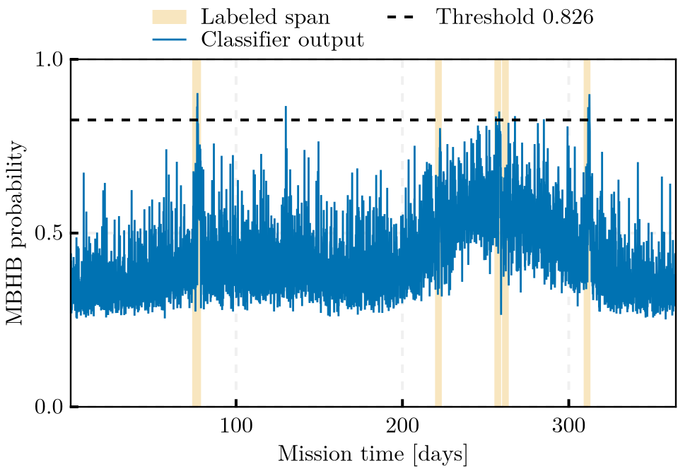

# MilliHertzQML

MilliHertzQML is a Julia pipeline for the detection of massive black hole
binary (MBHB) coalescences in LISA telemetry by a variational quantum
classifier (VQC) with data re-uploading. The circuits are simulated with
`Yao.jl`; training uses `Zygote.jl` gradients and `Flux.jl` optimisers.
The classification approach follows Isfan et al. [IsfanEtAl2025](@cite).

On the LISA Data Challenge 2a "Sangria" blind year, with decision
thresholds fitted on the training year and applied unchanged:

| | Selected configuration, `q8_b6` | Streaming configuration, `q8_b6_s001` |
|---|---|---|
| Completed blind year | 5 of 5 labelled events, 1.57 false alarms per 30 days | 5 of 5, 2.97 per 30 days |
| Streamed year, causal whitening | 6 of 6 coalescences alerted, one 0.3 hours before its merger and five after, 0.74 per 30 days | 5 of 6, each 11 to 28 hours before its merger, 0.33 per 30 days |
| Record scored at 0.43 % scattered batch loss | 9 % | 81 % |

!!! warning "Correction, 12 October 2026"
    The streamed-year alert tables first published with this release
    credited alerts from a signal onset defined against the analytic
    instrument noise, without the Galactic foreground that the noise of
    the record contains. They were re-credited after the release from the
    stored replays, with the onset defined against the record's own noise,
    which the code of this release does not compute. The credited alerts
    are unchanged except those of event 3, now credited at an earlier
    alert; the false-alarm rates are lower by up to 0.3 per 30 days; the
    completed-record results and the 30-day missions of the lossy-link
    study are not affected. The replay figures are those of the release.
    See [Telemetry replay and alert
    latency](benchmark.md#Telemetry-replay-and-alert-latency).

The selected configuration, eight qubits, four re-uploading layers and six
band powers between 0.3 and 40 mHz, was chosen on the training year by a
rule fixed before the blind year was scored. Trained at four seeds, every
configuration with four or six bands from 0.3 mHz upwards recovers all five events in
every run, and the false-alarm rates of the configurations do not differ
beyond the scatter between seeds, which for the selected one spans 1.57
to 8.74 per 30 days. The completed record
is whitened by the full-record PSD of the blind year, available only after
the whole record has been received; the streamed year is whitened
causally, from data already delivered to the ground station.

*Correction, 15 October 2026: this page first described the band powers as sub-mHz; the bands span 0.3 to 40 mHz (see the [benchmark page](benchmark.md)).*

The streaming configuration is the selected one retrained on a Welch
whitening spectrum smoothed in log-frequency, which shortens the stretch
of data every window needs from 1.16 days to 2.8 hours. At each of four
initialisation seeds it alerts five or six of the six coalescences before
their merger, at 0.33 to 1.32 false alarms per 30 days. An alert counts
for a coalescence only from its signal onset, the first window in which
the signal, conditioned as the record is, reaches a norm of 3 against the
record's own noise; release 1.2.0 credited the whole four-day label span,
releases 2.0.0 to 2.0.1 an onset defined against the instrument noise
alone (see the
[corrections](benchmark.md#Telemetry-replay-and-alert-latency)). The
[Sangria Benchmark](benchmark.md) page gives the protocol, every run, and
the limits of these results.



## Pipeline

Every stage is a library function behind a thin script that takes the
configuration file as its first argument
(`julia scripts/<stage>.jl configs/default.toml [--run-id ID] ...`); the
TOML file is the single source of every parameter and is validated on
load.

**Batch path**, on a completed record:

1. `scripts/generate_data.jl` (`generate_telemetry`) simulates continuous
   milliHertz telemetry at physical strain amplitude: Robson–Cornish–Liu
   noise [RobsonCornishLiu2019](@cite), resolvable galactic binaries and
   EMRIs, and IMRPhenomA MBHB injections [AjithEtAl2008](@cite) at a
   prescribed matched-filter SNR, written to HDF5 with point-wise labels
   and an event catalogue. For an LDC product, `scripts/label_ldc.jl`
   (`label_truth_stream`) derives the labels from the truth stream
   instead.
2. `scripts/preprocess_ldc.jl` (`preprocess_record`) whitens the A channel,
   by the strain model, the LDC TDI noise model, or a Welch estimate of the
   record, optionally smoothed in log-frequency, and extracts one feature
   vector per sliding window: band powers of the whitened spectrum, its
   entropy and its log power spread.
3. `scripts/train.jl` (`train_classifier`) splits the windows
   chronologically into training, validation and test blocks, trains the
   VQC with Adam and early stopping on the validation block, fits the
   decision threshold on the calibration block, and scores the test block
   once.
4. `scripts/infer.jl` (`evaluate_classifier`) applies the persisted
   threshold to a feature table and reports window- and event-level
   metrics with diagnostic figures.

**Streaming path**, on a telemetry mission:
`scripts/export_telemetry_payload.jl` writes a product as the payload of
the DeepSpaceTelemetry.jl producer, and `scripts/infer_telemetry.jl`
replays or follows the producer's run directory, scoring every window
once the stretch of data around it has reached the ground and timing the
alerts against the coalescences.

Every artifact carries git and hardware provenance, existing files are
backed up rather than overwritten, and each stage checks its memory
estimate against `[resources]` before allocating.

**Quick start**, on simulated telemetry:

```bash
julia scripts/generate_data.jl configs/default.toml --run-id sim01
julia scripts/preprocess_ldc.jl configs/default.toml \
    --h5-file data/inputs/simulated_telemetry_complex.h5 \
    --label-file data/inputs/simulated_telemetry_complex_labels.csv \
    --output-prefix telemetry_sim
julia scripts/train.jl configs/default.toml --run-id <RUN_ID>
julia scripts/infer.jl configs/default.toml --run-id <RUN_ID> --block test
```

The Sangria runs are reproduced by the commands at the end of the
[Sangria Benchmark](benchmark.md#Reproducing) page.

## Manual

- [Results](results.md): the figures and animations of the results, with
  short captions.
- [Physics & Data](physics.md): the noise model, the simulator, the
  constellation response, the features and the whitening, the LDC
  products, and the known physical deficiencies.
- [Quantum Architecture](architecture.md): the circuit, the evaluation
  protocol, training, the decision threshold, and the pipeline
  architecture.
- [Telemetry Coupling](telemetry.md): the payload export, the replay of a
  producer run, the whitening of a streamed record, and the alert table.
- [Sangria Benchmark](benchmark.md): the results on the LDC blind year,
  completed and streamed, over a lossy link, and of the streaming
  configuration with smoothed whitening.
- [API Reference](api.md) and [References](references.md).
