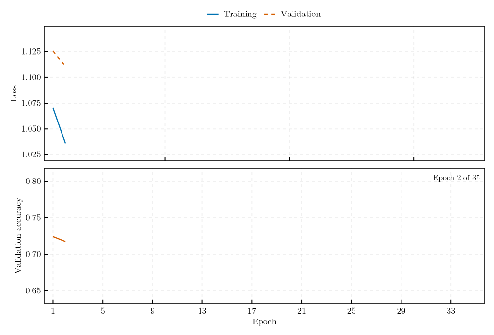

# Results

The figures on this page summarise the results on the LISA Data Challenge
2a "Sangria" data set. The [Sangria Benchmark](benchmark.md) page gives the
protocol, every run, and the limits of each result; the decision thresholds
are fitted on the training year and applied unchanged to the blind year.

| | Selected configuration, `q8_b6` | Streaming configuration, `q8_b6_s001` |
|---|---|---|
| Completed blind year: label spans, false alarms per 30 d | 5 of 5, **1.57** | 5 of 5, 2.97 |
| Streamed year, causal whitening: coalescences alerted before the merger | 1 of 6, 0.3 h ahead; the other five after it | **5 of 6** (6 of 6 at three further seeds) |
| Alert time at the ground station | 0.3 h before to 42 h after the merger | **11 to 28 h before** |
| Streamed year: false alarms per 30 d | 0.74 | **0.33** (0.99 to 1.32 at the further seeds) |
| Conditioning lag of every alert | 1.16 days | **2.8 hours** |
| Record scored at 0.43 % scattered batch loss | 9 % | **81 %** |

!!! warning "Correction, 12 October 2026"
    The streamed-year alert tables first published with this release
    credited alerts from a signal onset defined against the analytic
    instrument noise, without the Galactic foreground that the noise of
    the record contains. They were re-credited after the release from the
    stored replays, with the onset defined against the record's own noise,
    which the code of this release does not compute. The credited alerts
    are unchanged except those of event 3, now credited at an earlier
    alert; the false-alarm rates are lower by up to 0.3 per 30 days; the
    completed-record results and the 30-day missions of the lossy-link
    study are not affected. The replay figures are those of the release.
    See [Telemetry replay and alert
    latency](benchmark.md#Telemetry-replay-and-alert-latency).

Alerts are credited to a coalescence only from its signal onset, the first
window in which its signal, conditioned as the record is, reaches a norm
of 3 against the record's own noise; the figures of release 1.2.0 credited
the whole four-day label span, those of this release an onset against the
instrument noise alone: the replay figures below begin their shaded spans
at those onsets and mark event 3 at the alert then credited, while the
captions give the re-credited numbers (see the
[corrections](benchmark.md#Telemetry-replay-and-alert-latency)).

## The completed blind year

*The selected model over the blind year, whitened by its full-record PSD,
with the five labelled spans shaded. All five labelled events clear the
threshold, at 1.57 false-alarm episodes per 30 days where the fit on the
training year predicted 1.38. The bulk of the noise score rises between
day 200 and day 300: the Galactic foreground seen through the rotating
antenna pattern of the constellation.* See the
[results of the grid](benchmark.md#Results).

*The operating characteristic of the blind year, computed after the fact.
Event recall stays at one up to the threshold fitted on the training
year, so the operating point is set by the false-alarm rate alone.*

## Re-initialisation

*The selected configuration at four initialisation seeds, each refitting
its own threshold. Every seed recovers all five events; the delivered
false-alarm rate spans 1.57 to 8.74 per 30 days, and the seed with the
lowest fitted threshold is the one whose operating point does not
transfer.* See [the spread under
re-initialisation](benchmark.md#The-spread-under-re-initialisation).

*Every configuration of the grid at four seeds. The configurations with
four or six bands from 0.3 mHz upwards recover all five events in every run, the
two-band ones in two of eight; apart from the 2000-sample windows, near 26
false alarms per 30 days at every seed, the rates do not differ beyond
the scatter between seeds, and the validation episodes, the selection
statistic, cannot rank the configurations.* See [the grid over four
seeds](benchmark.md#The-grid-over-four-seeds).

*Correction, 15 October 2026: this page first described the band powers as sub-mHz; the bands span 0.3 to 40 mHz (see the [benchmark page](benchmark.md)).*

## The streamed year

*The blind year streamed through a simulated telemetry mission with daily
ground-station passes and whitened causally, from data already delivered,
by the streaming configuration, trained on a Welch whitening spectrum
smoothed by 0.01 dex in log-frequency. Five of the six coalescences are
alerted at the ground station 11 to 28 hours before their merger, at four
false-alarm episodes in the year; the shaded spans run from the signal
onset of each coalescence to 27 minutes after its merger. The lower panel
gives the alert time of every coalescence against the availability
latency of every window, the wait for its conditioning stretch of 2.8
hours plus the downlink delay.* See [smoothed
whitening](benchmark.md#Smoothed-whitening).

*The same replay in the order in which the ground station received the
windows. The dotted line is the ground clock; its distance from the edge
of the received data is the availability latency.*

*The selected configuration on the same mission. Its conditioning stretch
of 1.16 days delays the alerts: all six coalescences are alerted, five of
them 1.9 to 42 hours after the merger and event 3 0.3 hours before it, at
0.74 false-alarm episodes per 30 days.* See the [telemetry
replay](benchmark.md#Telemetry-replay-and-alert-latency).

*The selected configuration whitened by the full-record PSD of the blind
year, which no mission has while it observes: a non-causal upper
reference, with the same alerts to within half an hour, at 0.66
false-alarm episodes per 30 days.*

## A lossy link

*Seventeen 30-day missions, each differing from a lossless reference in
one property of the channel or the spacecraft, replayed with the selected
model. Scattered permanent loss is what removes windows; bursts,
retransmission and outages remove few or none. The streaming
configuration, whose conditioning stretch is 50 batches, scores 81 % of
the record at 0.43 % loss and alerts both coalescences in every
mission.* See the [effect of a lossy
link](benchmark.md#Effect-of-a-lossy-link).

*A window is scored only once its whole conditioning stretch of 410
batches has arrived, so the scorable fraction follows `(1 − p)^410` and
collapses beyond about 0.2 % of permanently lost batches.*

## Training

*The training history of the selected run, epoch by epoch, with the
checkpoint selected by early stopping on the validation block.*
